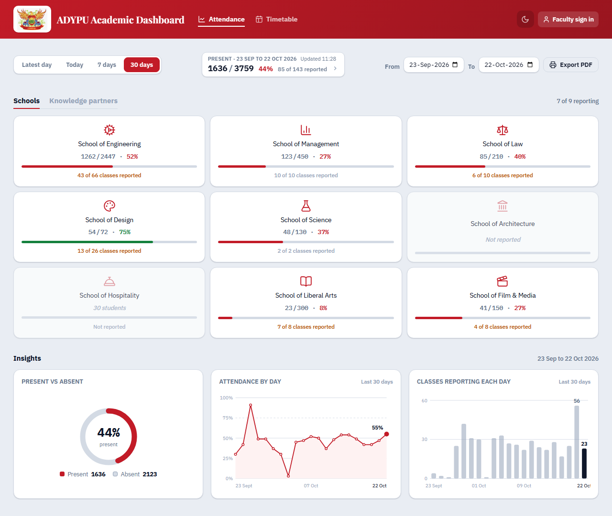
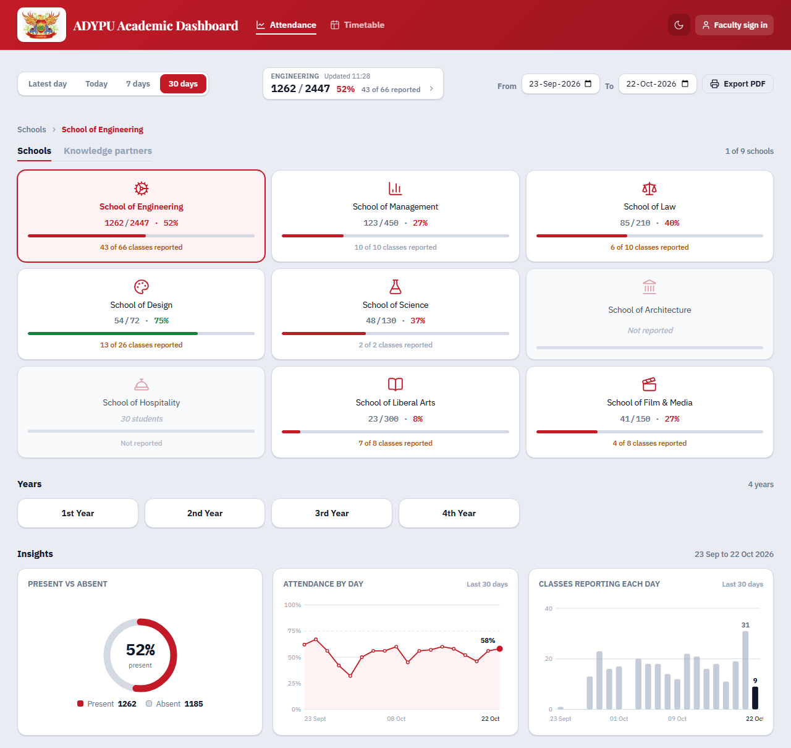
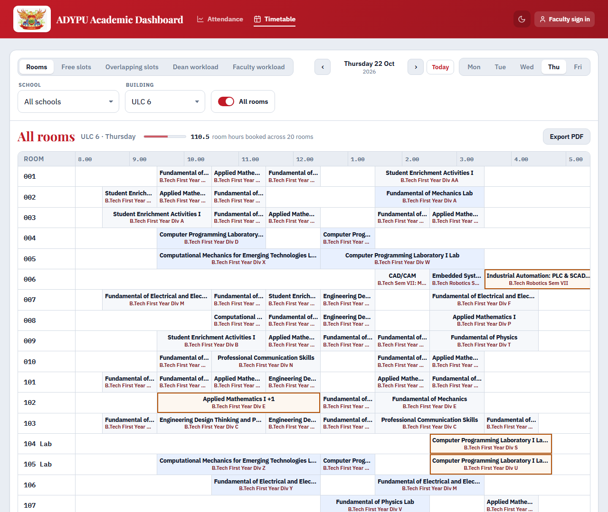
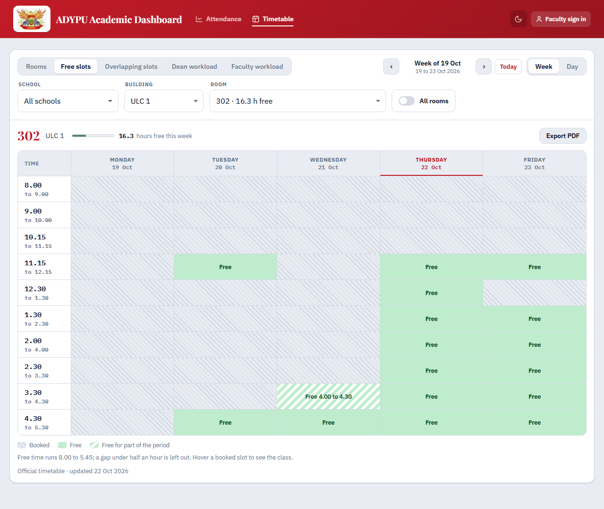

# ADYPU Academic Dashboard

Daily attendance and room timetables for Ajeenkya D Y Patil University.

**Live:** <https://adypu-daybook.fast-page.org/>



<sub>Figures in the screenshots are sample data.</sub>

## Attendance

- **Honest numbers.** Present against the strength of the classes that reported, always shown with how many reported.
- **Any date range.** Presets or custom dates. A range averages each class's days, so a week compares with a day.
- **Drill down.** School, year, branch, division. The summary and charts follow.
- **Export PDF.** A dated report of whatever is on screen.
- **Knowledge partners** have their own tab and never count toward a school.



## Room timetable

- **Rooms.** Any room's week, picked by school and building.
- **Free slots.** The same timetable with free time in green, for finding a room for an extra class.
- **All rooms.** One switch shows every room's day on a single screen.
- **Dean workload.** One person's week across every room.
- **Attendance in the cell.** Tap a class to see its attendance by division.





## Faculty accounts

- **Sign up** with the school's join code, or wait for an admin to approve.
- **Mark attendance** from a phone: tick the absentees, or type a count.
- **Admins** approve accounts, rotate join codes, reset passwords and see usage.

The dashboard and timetable are open to everyone. Only marking needs an account.

## How data arrives

```
Google Form -> Sheet -> Apps Script --push--> api/ingest.php -> cache/attendance.json --+
                                                                                       +--> the dashboard
Faculty phone -> mark.php ---------------------------------> data/submissions.php ----+
```

- The class list and strengths come from `includes/structure.php`, never from a submission.
- A class that did not report still counts toward strength and is flagged as unreported.

## Run it locally

PHP 8, no framework, no build step.

```bash
php -S localhost:8000
```

Open <http://localhost:8000/index.php>. With no data it shows sample figures.

Tests are plain assert scripts:

```bash
php -d zend.assertions=1 tests/test_attendance_parser.php
php -d zend.assertions=1 tests/test_marking.php
php -d zend.assertions=1 tests/test_timetable.php
node tests/test_charts.js
```

## Deploy

- `tools/stage-upload.sh <ref>` copies the changed files into `upload/`, paths intact.
- Drop `upload/` onto the server's `htdocs` over FTP.
- `includes/config.local.php` lives only on the server (see `config.local.example.php`).

## Project layout

| Path | What it is |
| --- | --- |
| `index.php` | Attendance dashboard |
| `rooms.php` | Room timetable, Free slots, All rooms, Dean workload |
| `mark.php`, `login.php`, `admin.php` | Faculty marking and accounts |
| `stats.php` | Usage, admins only |
| `api/` | Push endpoint and the division breakdown |
| `includes/` | Parsing, structure, timetable, accounts, storage |
| `js/`, `css/` | Front end, no libraries |
| `tools/` | Apps Script, roster import, timetable build, upload staging |
| `tests/` | Assert-based test scripts |
