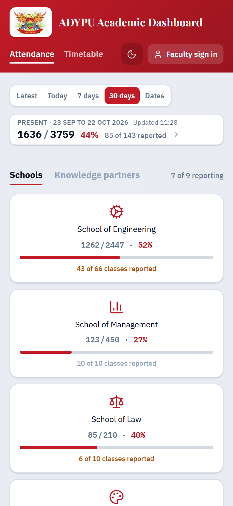
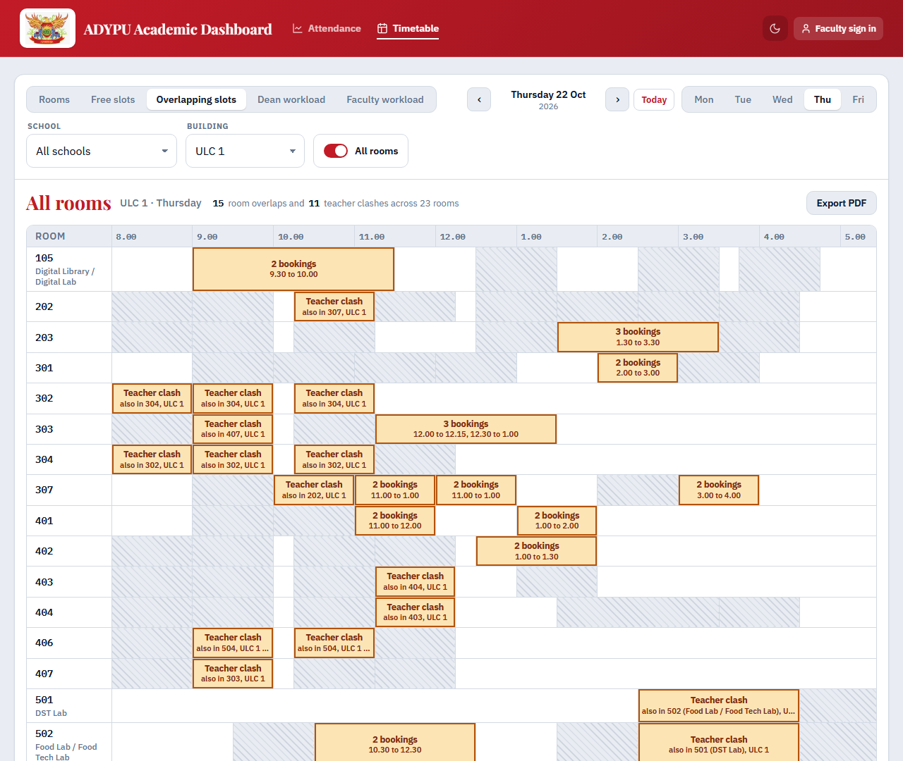
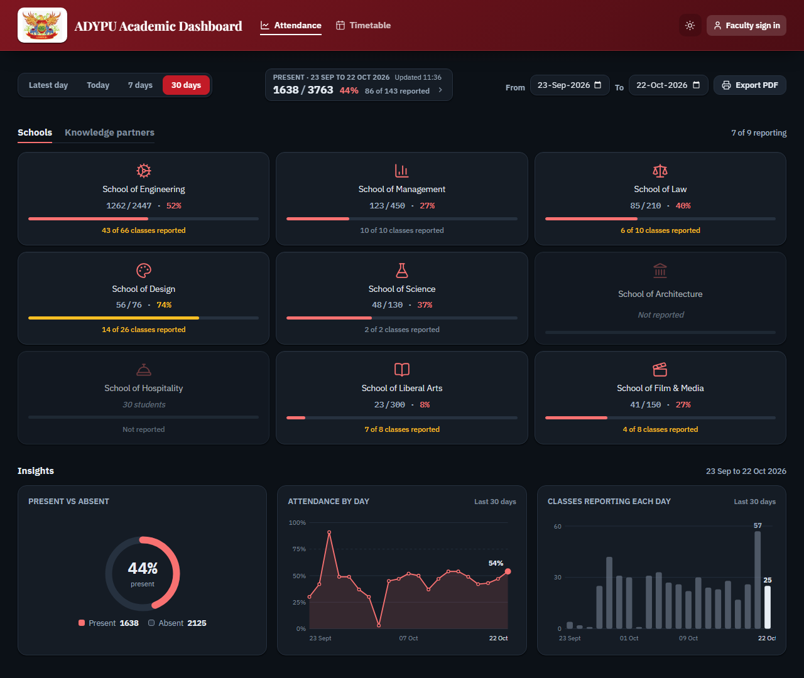
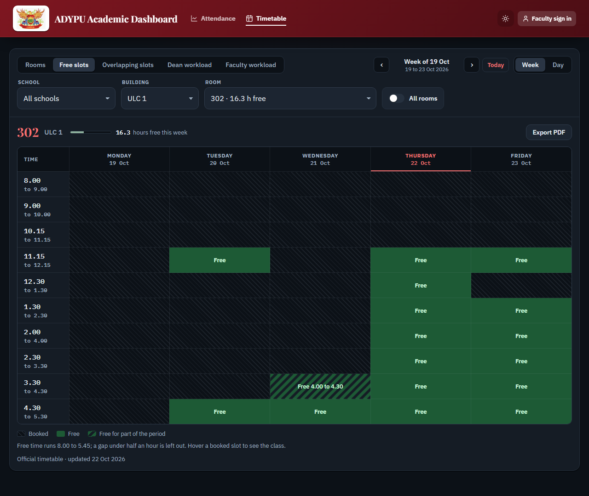
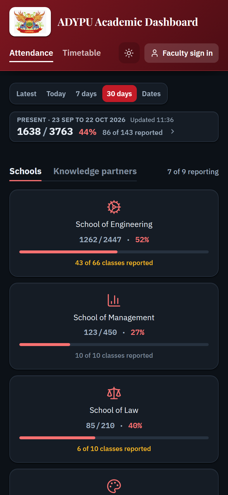

# ADYPU Academic Dashboard

Daily attendance, room timetables and teaching workload for Ajeenkya D Y Patil University.

Live site: <https://adypu-daybook.fast-page.org/>

#### Dashboard, desktop


## Attendance

- Present counts are measured against the classes that reported, and the page always says how many did.
- Students enrolled sits under the present count for the same scope: real headcounts only, with how many classes they cover.
- Pick a preset or any dates. A range averages each class's days, so a week reads like a day.
- Drill down by school, year, branch and division; the summary and charts follow.
- Export PDF gives a dated report of whatever is on screen.
- Knowledge partners have their own tab and never count toward a school.
- Every page fits a phone screen, and wide grids scroll inside themselves.

#### School of Engineering drill-down, desktop


#### Dashboard, phone



## Room timetable

- Rooms: any room's week, picked by school and building.
- Free slots: the same week with free time in green, for finding a room for an extra class.
- All rooms: every room's day on one screen.
- Overlapping slots: rooms booked twice at once, and teachers down for two rooms at once.
- Dean and Faculty workload: one person's week across every room, with their weekly hours.
- The workload list puts every teacher in a school next to their weekly hours, ready to export as PDF.
- Tap a class to see its attendance by division.

#### All rooms in one building, desktop


#### Free slots for one room, desktop


#### Overlapping slots, desktop



## Dark mode

The moon button in the header switches it, and the choice is remembered.

#### Dashboard, desktop, dark



#### Free slots for one room, desktop, dark



#### Dashboard, phone, dark



## Faculty accounts

- Faculty sign up with their school's join code, or wait for an admin to approve them.
- Marking works from a phone: tick the absentees, or type a count.
- Admins approve accounts, rotate join codes, reset passwords and see usage.
- The admin activity log shows sign-ins, marks and failures, with a leaderboard of Form and app entries.
- The dashboard and timetable are open to everyone; only marking needs an account.

## How data arrives

```
Google Form -> Sheet -> Apps Script --push--> api/ingest.php -> cache/attendance.json --+
                                                                                       +--> the dashboard
Faculty phone -> mark.php ---------------------------------> data/submissions.php ----+
```

- Classes and their strengths come from `includes/structure.php`; a submission only adds a present count.
- A class that did not report still counts toward strength and is marked as unreported.

## Run it locally

PHP 8 with no framework and no build step.

```bash
php -S localhost:8000
```

Open <http://localhost:8000/index.php>. With no data, it shows sample figures.

The tests are plain assert scripts:

```bash
php -d zend.assertions=1 tests/test_attendance_parser.php
php -d zend.assertions=1 tests/test_marking.php
php -d zend.assertions=1 tests/test_timetable.php
php -d zend.assertions=1 tests/test_activity.php
node tests/test_charts.js
```

## Deploy

- `tools/stage-upload.sh <ref>` copies the changed files into `upload/`, paths intact.
- Drop `upload/` onto the server's `htdocs` over FTP.
- `includes/config.local.php` lives only on the server (see `config.local.example.php`).

## Project layout

| Path | What it is |
| --- | --- |
| `index.php` | Attendance dashboard |
| `rooms.php` | Room timetable, Free slots, Overlapping slots, Dean and Faculty workload |
| `mark.php`, `login.php`, `account.php`, `admin.php` | Faculty marking and accounts |
| `stats.php`, `activity.php` | Usage and the activity log, admins only |
| `api/` | Push endpoint and the division breakdown |
| `includes/` | Parsing, structure, timetable, accounts, storage |
| `js/`, `css/` | Front end, no libraries |
| `tools/` | Apps Script, roster import, timetable build, upload staging |
| `tests/` | Assert-based test scripts |
